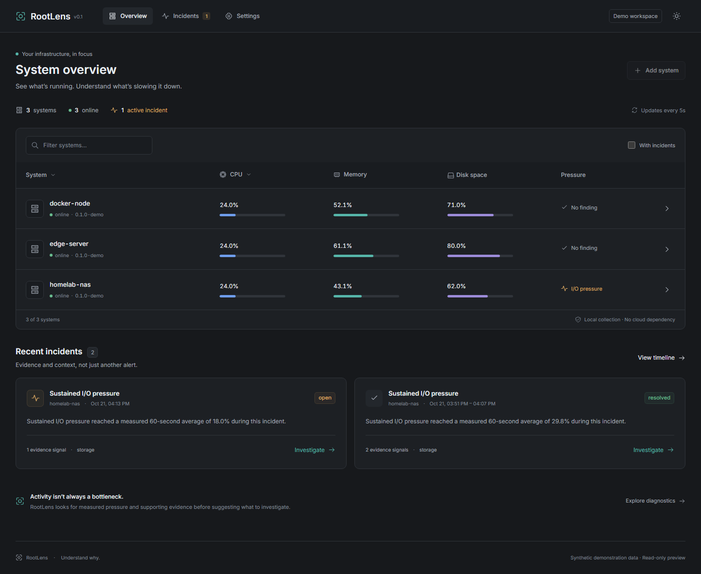

# RootLens

**Understand why your server is slow.**

RootLens is a self-hosted Linux monitoring and diagnostics application. It combines
a compact dashboard with deterministic incident reports: what was measured, which
resource was under pressure, which workloads may have contributed, and what the
available evidence cannot establish. It runs without a cloud account or AI service.

This repository contains the first v0.1 implementation. It is **not yet a
production-qualified release**: real NAS qualification, native ARM64 testing,
long-duration failure tests and the N95 resource budgets remain release gates.
See [validation](docs/validation.md) for the exact evidence and limits.



## Try the local preview

Build the hub, then run:

```sh
rootlens demo --data ./demo-data --listen 127.0.0.1:8765
```

Open <http://127.0.0.1:8765>. The preview is read-only, uses clearly identified
synthetic data, and runs the same SQLite ingestion and diagnostic engine as real
agents. It binds only to a loopback address. It does not monitor your machine.

## Included

- Go hub with embedded Vue 3 dashboard, local administrator authentication and TLS.
- Linux agent with proc/sysfs, PSI, cgroups v2 and optional Docker collection.
- CPU, memory, swap, load, filesystem capacity, block I/O, network and sensors.
- Optional current process CPU/RSS leaders, with no command lines or process history.
- Five diagnostic families: I/O pressure, CPU contention, memory pressure,
  container throttling, and observed OOM/restart instability.
- Persistent incidents, evidence summaries, historical charts and Markdown/JSON reports.
- Idempotent ingestion, bounded retry buffering, rollups, retention and backups.
- Dark/light themes, responsive layouts and accessible chart data tables.
- Compose, systemd examples, restricted Docker API proxy policy and release workflows.

## Build from source

Prerequisites: Go 1.27.3+, Node 22.12+ (Node 22 is used in container builds), npm.

```sh
cd web
npm ci
npm run build
cd ..
go build -trimpath -o dist/rootlens ./cmd/rootlens
go build -trimpath -o dist/rootlens-agent ./cmd/rootlens-agent
```

On Windows use `.exe` output names and `npm.cmd` where PowerShell requires it.
The hub and fixture preview work on Windows; the monitoring agent requires Linux.
The built dashboard is embedded in the hub. No Node runtime is needed in production.

## Install

With Docker Engine and the Compose plugin already installed on a Linux AMD64 or
ARM64 host, run:

```sh
curl -fsSL https://raw.githubusercontent.com/silkute/RootLens/main/install.sh | sudo sh
```

The installer downloads a pinned preview, verifies the bundle checksum, initializes
HTTPS and enrolls a local agent. It uses `./rootlens`, detects a local IPv4 address
and prints the dashboard URL and CA certificate location. Trust that certificate
on your browser device, then create your administrator account using the one-time
token shown only on an interactive terminal (also saved privately as `setup.token`).
Docker container monitoring is opt-in: add `-s -- --docker` after `sudo sh`.
See [installer options](docs/installation.md#one-command-installation) for a custom
NAS folder, address, port, offline installation and repeat-run behavior.

Download the versioned **Docker installation ZIP** from
[Releases](https://github.com/silkute/RootLens/releases), extract it, and follow its
`INSTALL.md`. The bundle uses prebuilt AMD64/ARM64 images from GHCR; no source build
is needed. HTTPS initialization and host enrollment remain explicit setup steps.

See [installation](docs/installation.md) for TLS trust, Compose enrollment, binary
deployment and optional Docker access. Start with one noncritical Linux machine.
Modern Linux with PSI and cgroups v2 is the primary diagnostic target. Older kernels
are capability-limited; missing data never becomes zero.

Disk **space**, device **activity**, and workload **pressure** are different signals.
High device busy time alone is not reported as saturation. Container attribution is
only a possible contribution, never proof of causation.

## Development and verification

```sh
go test ./...
go vet ./...
go run ./cmd/contracts
cd web
npm run typecheck
npx playwright install chromium
# Run the local preview on port 8765 in another terminal first:
npm run test:e2e
```

`npm run dev` starts Vite and proxies API reads to the local preview. Production
authentication is tested against the Go TLS server, not this development proxy.
Go transport types generate OpenAPI, the metric registry and TypeScript interfaces.
CI checks regeneration for drift.

## Documentation

- [Architecture and implementation decisions](docs/architecture.md)
- [Installation, upgrades and backups](docs/installation.md)
- [API usage and contracts](docs/api.md)
- [Collectors, permissions and limitations](docs/collectors.md)
- [Diagnostic interpretation](docs/diagnostics.md)
- [Validation and release gates](docs/validation.md)
- [Contributing](CONTRIBUTING.md) · [Security reporting](SECURITY.md)

MIT licensed. Beszel is the principal visual reference; RootLens uses original
branding and components. See [third-party notices](THIRD_PARTY_NOTICES.md).
